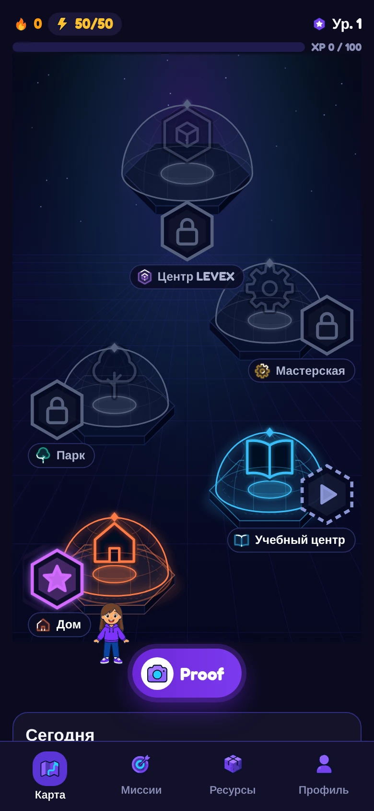
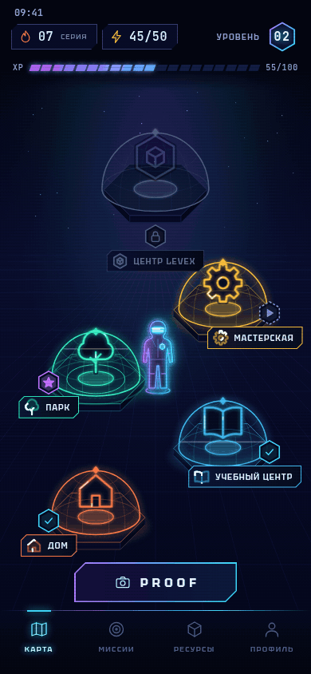
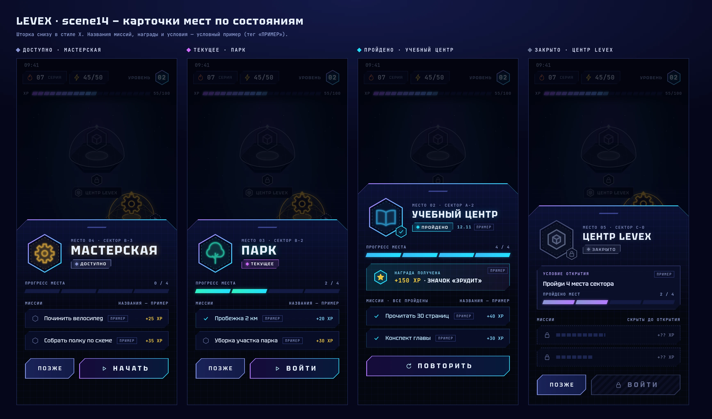
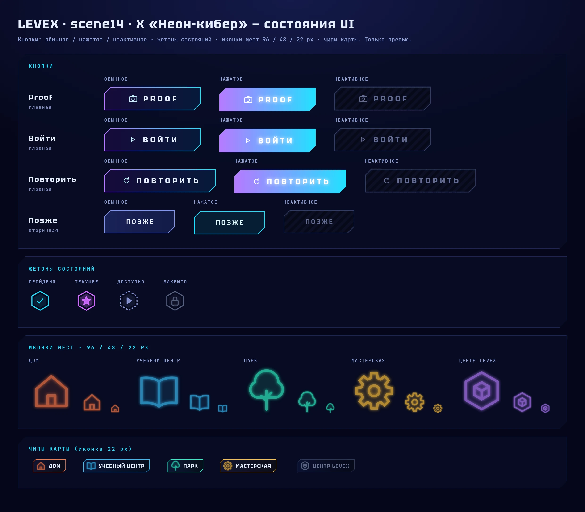
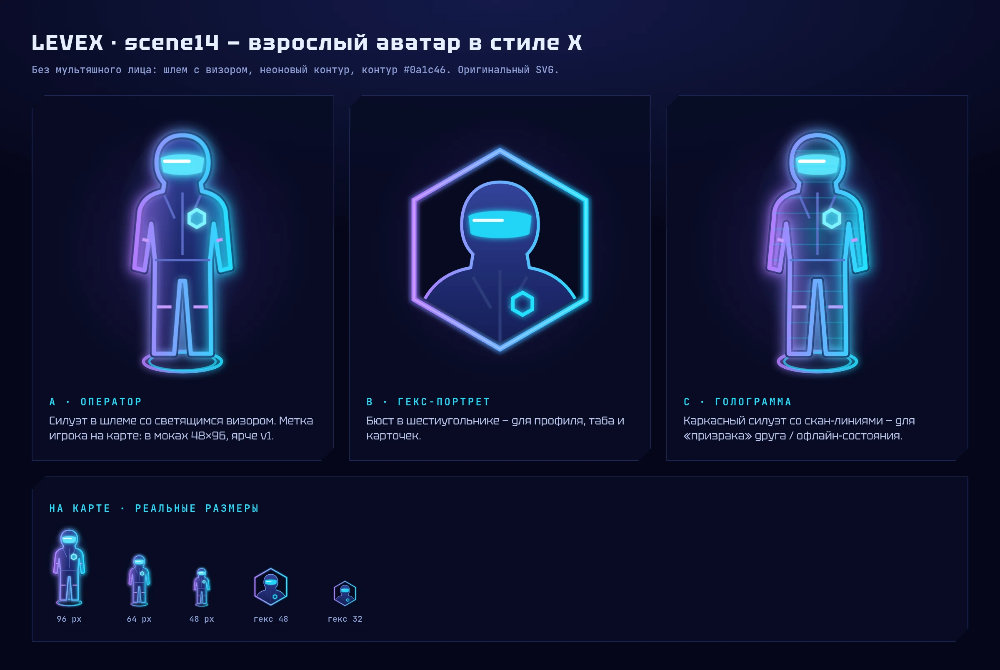
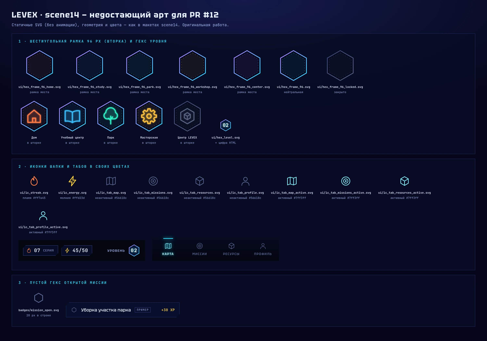
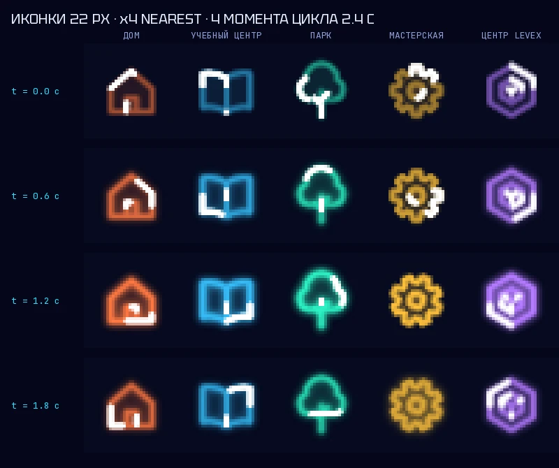
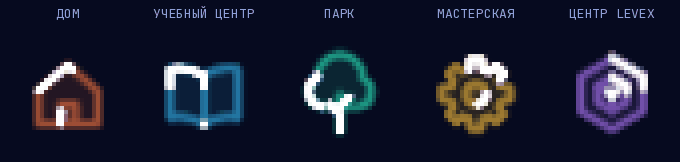

# Превью art/scene14 — направление X «Неон-кибер»

Ассеты: `apps/web/public/art/scene14/`. Токены: `apps/web/src/theme/levex-x.css`, `levex-x.tokens.json`.
Как подключить: [INTEGRATION.md](INTEGRATION.md), готовый патч для PR #10: [pr10-wiring.patch](pr10-wiring.patch).

Локальная проверка поверх PR #10 (ветка `cursor/levex-vector-ui` + этот набор + патч), 390×844:

| Главный экран 390×844 | Анимация (цикл 2.4 с) |
|---|---|
|  |  |

Карточки мест (доступно / текущее / пройдено / закрыто). Названия миссий, награды и условия — пример.

Состояния UI: кнопки обычное / нажатое / неактивное, жетоны, иконки 96 / 48 / 22, чипы.

Аватар: A «Оператор» (на карте), B «Гекс-портрет», C «Голограмма» (запасные).

Вторая партия для PR #12: рамка 96 px, гекс уровня, иконки шапки и табов, пустой гекс открытой миссии:

Проверка 22 px (×4 nearest-neighbor):

 

Отдельные карточки: [доступно](mock_sheet_open_390x844.webp) · [текущее](mock_sheet_current_390x844.webp) ·
[пройдено](mock_sheet_done_390x844.webp) · [закрыто](mock_sheet_locked_390x844.webp)
